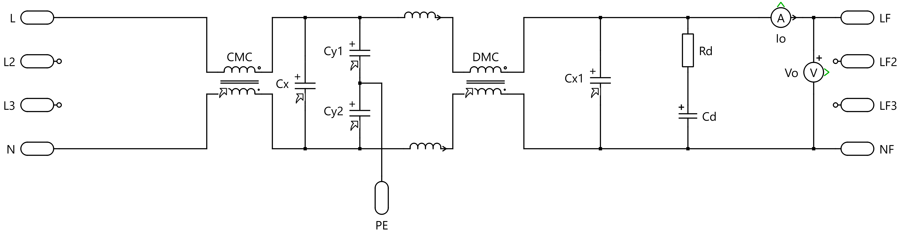
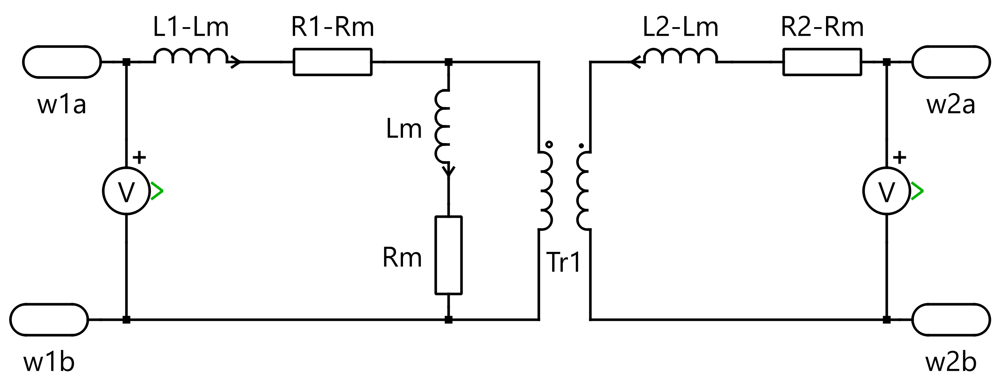
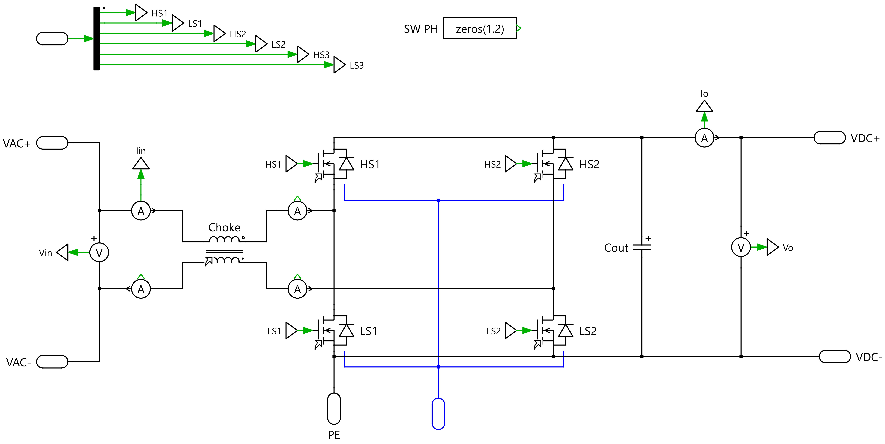

# 1 kW Totem-Pole Bridgeless PFC

> [!IMPORTANT]
> The component libraries used by the PLECS model are not included in this repository. Get them from [Gueni/0000_libraries](https://github.com/Gueni/0000_libraries) before opening or running the simulations.

Design and simulation of a single-phase, **non-interleaved** totem-pole bridgeless PFC (TPB PFC) rated at 1 kW / 400 V DC. One fast leg switches at PWM frequency (HS1/LS1, SiC), and one slow leg switches at line frequency (HS2/LS2) and replaces the diode bridge. The model is built in PLECS and driven from Python: a parameter sweep, an HTML report with waveforms and harmonics, logs, and optional code generation for a PLECS RT Box.


The top level chains **grid → EMI filter → PFC stage → DC link (CDC) → load**. The PFC controller (`PFC CTRL`) drives the gates through `g_PFC`. The switches' thermal port goes to ambient through `Rth H-A`. `Scopes` and `Data Export` (the To File block that writes the result CSV) hold the measurements.

## Specifications

| Parameter | Value |
|---|---|
| Output power | 1 kW (load step at t = 0.55 s) |
| Output voltage | 400 V DC |
| Input voltage | 85–265 Vrms, 50 Hz (nominal 230 Vrms) |
| Switching frequency | 80 kHz (fast leg), 50 Hz (slow leg) |
| Boost inductance | 248 µH effective |
| Inductor ripple | 5.0 A p-p max, 30 % of the 16.6 A line peak at 85 Vrms |
| DC-link capacitance | 480 µF (470 µF electrolytic + 10 µF HF) |
| DC-link ripple | ≈ 16.6 V p-p at 100 Hz (4.1 %) |
| Hold-up | ≈ 16.8 ms from 400 V down to 300 V at 1 kW |

## Power stage

### Grid


The grid is an ideal sine source, `√2 · Vin · sin(2π · f · t)`, with a series resistance in line and neutral. L2/L3 are only used by the three-phase configuration.

| Parameter | Value |
|---|---|
| `Grid.Vin` | 230 Vrms |
| `Grid.f` | 50 Hz |
| `Grid.R` | 10 mΩ per conductor |

### EMI filter



A two-stage differential-mode (DM) filter with a common-mode choke, library block `Power/EMI FILTER`. It has three configurations: `1 = 1PH` (used), `2 = 3PH` and `3 = Pass`. The signal path is:

CMC → Cx, with Cy1/Cy2 to PE → series inductors L1/L5 → DMC → Cx1 ∥ (Rd + Cd) → PFC

| Part | Value | Part type |
|---|---|---|
| CMC | 4.7 mH per winding, k = 0.995, 30 mΩ | nanocrystalline, 10 A; its 23.5 µH leakage per winding is the stage-1 DM inductance |
| DMC | 120 µH per winding, uncoupled, 25 mΩ | powder core, 10 A |
| L1, L5 (`Ll`) | 2 µH | wiring between the stages |
| Cx (grid side), Cx1 (PFC side) | 1 µF each | X2 film, 310 VAC (separate structs `AC_Filter.Cx`, `AC_Filter.Cx1`) |
| Rd + Cd across Cx1 | 10 Ω + 4 µF | parallel RC damper of stage 2 (n = Cd / Cx1 = 4, Rd ≈ 0.6 · √(L / Cx1)) |
| Cy1, Cy2 | 2.2 nF each | Y1 ceramic (leakage 0.18 mA at 265 V) |

| Figure | Value |
|---|---|
| Stage 1 (47 µH, Cx) | ≈ 23 kHz |
| Stage 2 (244 µH, Cx1) | ≈ 10 kHz, characteristic impedance 15.6 Ω, damped by Rd + Cd |
| DM attenuation at 2 · fsw = 160 kHz | ≈ 80 dB |
| Grid current at 230 V / 1 kW | PF 0.9994, THD 1.9 % (1 s simulation) |

The capacitors use the ideal model (`Config` 1): the damping comes from Rd + Cd, and leaving out the nanosecond ESR poles keeps the simulation fast.

> [!IMPORTANT]
> The controller measures vac and iL at the PFC terminals (probes `PFC` → `Input Voltage` / `Input Current`), not at the grid. If the current loop measures the grid current instead, it is closed through the filter's LC resonances, which are close to its 8 kHz crossover, and the converter runs away.

### Coupled inductors (CMC, DMC, boost choke)



The CMC, the DMC and the PFC boost choke all use the same `Magnatic Components/Choke` block. It is a two-winding mutual inductance with self inductances L1/L2, mutual inductance Lm, winding resistances R1/R2 and mutual resistance Rm. Each winding sees a leakage inductance of `L − Lm`. For the boost choke the current loop sees `L_boost = L1 + L2 − 2·Lm`.

### PFC stage



The boost choke sits between the AC input and the switch node of the fast leg (HS1/LS1). The slow leg (HS2/LS2) connects the other AC line to the DC rails according to the line polarity. `Cout` is the high-frequency decoupling capacitor on the DC bus. Gate signals for HS3/LS3 exist for other configurations and stay off in the `TPB PFC` configuration.

| Parameter | Value |
|---|---|
| Boost choke | L1 = 240 µH, L2 = 10 µH, Lm = 1 µH → **L_boost = 248 µH**, 10 mΩ per winding |
| `PFC.Cout` | 10 µF |
| Dead time | 300 ns |

### Switches


Each switch is a MOSFET with a body diode and an optional Coss, plus a Cauer/Foster thermal chain to the heatsink. Losses come from the thermal description files.

| Parameter | Value |
|---|---|
| Device (thermal model) | Wolfspeed C3M0021120K, 1200 V SiC |
| R_DS(on) | 65 mΩ |
| Body diode | Vf = 4.5 V, 5 mΩ |
| Gate resistance | 2.5 Ω on / off |
| Coss | 180 pF (configuration 5 = bypassed) |
| Thermal | R_th j-c = 0.1 K/W, c-h = 0.1 K/W, h-a = 0.09 K/W, T_amb = 25 °C |

### DC link


The capacitor model is C + ESR + ESL (`Passives/C`). Its configurations are 1 Ideal, 2 ESR, 3 ESL, 4 ESR + ESL, 5 Pass and 6 Short. The DC link uses configuration 4.

| Parameter | Value |
|---|---|
| `DCLink.Cap_s` | 470 µF |
| ESR / ESL | 50 mΩ / 1 pH |
| Initial voltage | √2 · Vin (pre-charged, inrush bypass assumed) |

### Load


The load is a switchable resistive / RL load (RL1, RL2, RL3) with a freewheeling path (RF, DF). It takes a load step at `Load.t_switch`.

| Parameter | Value |
|---|---|
| `Load.Pout` | 1 kW → R = 160 Ω at 400 V |
| Load step | t = tSim − load_tflip = 0.55 s |

## Control

The controller uses average current mode control in the `PFC CTRL` → `TPB PFC` configuration:

- **Voltage loop:** PI on `Vref − Vdc`. The error passes through a 20 Hz low-pass filter that attenuates the 100 Hz ripple. The output is the power command `P*`, limited to `[0, 1.5 kW]`.
- **Current reference:** `Iref = |Vac| · P* / Vrms²`, limited to `Ipk_max = 25 A`, the peak current at 1.5 kW and 85 Vrms.
- **Current loop:** PI on `Iref − |iL|` with input-voltage / Vdc duty feed-forward. The duty is limited to `Dmax = 0.98`.
- **Zero crossing:** all gates are blanked while `|Vac| < 20 V`. The slow leg follows the line polarity.
- **Soft start:** Vref ramps from √2 · Vin to 400 V over 0.2 s.

| Loop | Crossover | Kp | Ki |
|---|---|---|---|
| Current | fc_i = fsw / 10 = 8 kHz | 2π · fc_i · L_boost = 12.47 V/A | (2π · fc_i)² / 10 · L_boost = 62.7 kV/(A·s) |
| Voltage | fc_v = 10 Hz | 2π · fc_v · C_out · Vref = 12.06 W/V | (2π · fc_v)² / 2 · C_out · Vref = 379 W/(V·s) |

The gains are recomputed by `Derived.update()` in `derived.py` whenever a sweep changes L, C, fsw or Vref.

## Measurement chain and MCU

The controller never sees ideal signals. It runs inside an `MCU` subsystem and receives the outputs of real sensors through an ADC, like the firmware on the board.

```
power stage ──► Iin sense / Vac sense / Vdc sense ──► (Goto Iin_sns, Vac_sns, Vdc_sns)
                                                            │
MCU:  sensor voltage ──► ADC (12 bit, 3.3 V, sampled at fsw) ──► firmware scaling ──► PFC CTRL ──► g_PFC
```

| Sensor (library `Sensors`) | Placement | Model | Default |
|---|---|---|---|
| `Iin sense` (`A_sense`) | in series between the EMI filter and the PFC (line) | shunt + isolated amplifier: gain, gain/offset error, first-order bandwidth, mid-rail offset, clamp to the ADC rail | 5 mΩ + AMC1301: 50 mV/A, 1.65 V offset, 200 kHz, ±25 A → 0.4…2.9 V |
| `Vac sense` (`V_sense`) | across the PFC AC terminals | divider + RC anti-alias + isolated amplifier: two poles | 3.75 mV/V around 1.65 V, 10 kHz RC, 275 kHz amplifier |
| `Vdc sense` (`V_sense`) | across the PFC DC terminals | same as Vac | 6 mV/V (0…500 V → 0…3 V), 5 kHz RC |

`HA_sense` (Hall-effect current sensor) has the same model as `A_sense`, for Hall-type defaults.

The `ADC` block (library `Sensors`) models:
- gain and offset error;
- the input range 0…Vref;
- sample & hold every `Ts`, at offset `Toffs`;
- N-bit quantization (floor), output in counts 0…2ᴺ−1.

The MCU samples once per PWM period at the carrier valley (`Toffs = 0`), which gives the average inductor current.

The firmware scaling converts counts back to physical units with the **nominal** sensor gain and offset (`MCU.Cal`). Errors you set in `Sensors` (`err_g`, `err_ofs`) therefore reach the controller as real measurement errors.

All of this is set in `parameters.py`:
- `Sensors`: the hardware on the board, including its errors;
- `MCU.ADC`: resolution, reference, sampling;
- `MCU.Cal`: what the firmware assumes.

`derived.py` keeps `MCU.ADC.Ts = 1/fsw` when fsw is swept.

## Simulation

| Setting | Value |
|---|---|
| Simulation time | 0.6 s |
| Saved window | 0.4 s → 0.6 s (`ToFile.tsave`) |
| Solver | variable step, max step 1 ms, rel. tol. 1e-3, zero-crossing limit 1000 (1 s simulated in ≈ 1 min) |

## Running a sweep

```bash
python Lib/sweep.py
```

`sweep.py` simulates every combination of the values in `SWEEP`. `SWEEP_PATHS` sets where each swept value is written in `ModelVars`, and one swept value can drive several parameters. The flags at the top choose what runs:

| Flag | Effect |
|---|---|
| `SWEEP_EN` | Run the simulation sweep |
| `PARASIM` / `PARANUM` | Run sweep points in parallel. `PARANUM = None` sizes the batches from the CPU threads, keeping one free and spreading the points evenly over the batches. |
| `SCOPES` | Scopes to clear/hold/save. `None` = every scope found in the model, including only the active configuration of configurable subsystems and skipping commented-out blocks. `[]` = none. |
| `CODEGEN` | Generate code with PLECS Coder (`CODEGEN_TARGET` = subsystem with code generation enabled) |
| `RTBOX` | Upload and run the generated code on the RT Box at `RTBOX_URL` |

A sweep writes these outputs to `data/` (git-ignored):

```
data/
  timeseries/            Results_<run>_<n>.csv     waveforms of each sweep point (columns: time + Waveforms in parameters.py)
  mat/                   RMS_<run>.csv             one row per sweep point, one column per waveform
                         Average_<run>.csv
                         PeakToPeak_<run>.csv
                         Max_<run>.csv
                         Min_<run>.csv
                         Peak_<run>.csv            largest absolute value
                         FFT_<run>.csv             one row per sweep point and waveform: f0_Hz, H1 … H50
  html/                  Html_<run>.html           single report: for each waveform its time-domain figure then its
                                                   harmonic bar plot (every point overlaid), then the calculated
                                                   results table and the parameter table
  log/                   Log_<run>.log             base parameters, then the parameters changed by each iteration
  traces/                                          saved scope traces
```

The calculated results are computed once per time-series file, with one batch function per type in `pmath.py` (`rms`, `average`, `peak_to_peak`, `maximum`, `minimum`, `peak`, `harmonics`):

- **Window:** all types use the same steady-state window, the last `ANALYSIS_CYCLES` (5) whole cycles of the grid fundamental. Without a fundamental, they use the whole saved window.
- **RMS and average:** time-weighted, so they are correct on PLECS' variable-step samples.
- **Harmonics:** the x-axis is the harmonic order, and each title shows the fundamental used: `Grid.f` = 50 Hz by default, `CTRL.fsw` = 80 kHz for the fast-leg signals (`F0_OVERRIDES`).
- **Parameter table:** units, comments and values; a swept value is shown as `a / b / c`.

## Repository layout

```
asset/                 Schematics used in this README and the HTML report
doc/literature/        Reference papers and app notes
Model/
  PFC.plecs            PLECS model (power stage + control)
  tpbpfc_init.m        Stand-alone MATLAB/Octave first-cut design script (sizing from the specs)
Lib/
  sweep.py             Sweep definition and run flags (sweep / code generation / RT Box)   [system specific]
  parameters.py        Model paths, component parameters, waveforms                       [system specific]
  derived.py           Derived parameters, recomputed on every sweep point                 [system specific]
  pplecs.py            PLECS XML-RPC interface, scope detection, result folders, sweep points, batch sizing
  pplots.py            HTML report: waveforms, harmonic bar plots, parameter table
  plog.py              Sweep log
  pmath.py             Signal math: batch RMS, average, peak-to-peak, max, min, peak, harmonics; envelope
  rtbox.py             PLECS Coder code generation and RT Box run
data/                  Sweep outputs (git-ignored)
```

Only `parameters.py`, `derived.py` and `sweep.py` are specific to this converter. To simulate another system (LLC, OBC, DC-DC …), copy those files and edit them; the library modules stay unchanged. The header of `parameters.py` lists what it must define.

## Parameter structs (`ModelVars`)

| Struct | Contents |
|---|---|
| `Sim_param` | Simulation time, load step time, solver settings |
| `ToFile` | Saved window and output file paths (filled in per run) |
| `Grid` | Grid source: Vin, f, phase, line resistance |
| `AC_Filter` | EMI filter: CMC, DMC, Ll, Cx, Cy1, Cy2 |
| `PFC` | Boost choke, Cout, switches (electrical + thermal) |
| `DCLink` | DC-link capacitor |
| `CTRL` | Control loops, gains, limits, zero-crossing and soft-start settings |
| `Load` | Load power, R/L, load step |
| `Thermals` | Ambient temperature, heatsink-to-ambient thermal resistance |
| `Sensors` | Current and voltage sensors on the board: gain, offset, bandwidth, errors, output range |
| `MCU` | ADC (bits, Vref, sampling period / instant, errors) and the firmware calibration of the sensors |
