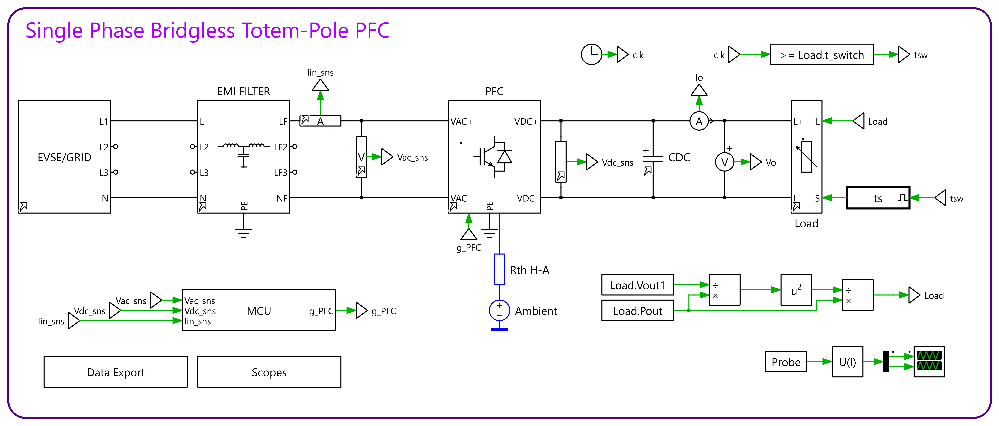

# 1 kW Totem-Pole Bridgeless PFC

> [!IMPORTANT]
> The component libraries used by the PLECS model are not included in this repository. Get them from [Gueni/0000_libraries](https://github.com/Gueni/0000_libraries) before opening or running the simulations.

Design and simulation of a single-phase, non-interleaved totem-pole bridgeless PFC rated at 1 kW / 400 V DC, with **average current mode control**. The model is built in PLECS and driven from Python: parameter sweeps, a single HTML report with waveforms and harmonics, logs, and optional code generation for a PLECS RT Box.



The signal path is **grid → EMI filter → PFC stage → DC link → load**. Sensors feed an MCU model (ADC + firmware scaling) that runs the controller and drives the gates.

## Specifications

| Parameter | Value |
|---|---|
| Output | 1 kW, 400 V DC |
| Input | 85–265 Vrms, 50 Hz (nominal 230 Vrms) |
| Switching frequency | 80 kHz fast leg (SiC), 50 Hz slow leg |
| Boost inductance | 248 µH |
| DC link | 480 µF |
| Result at 230 V / 1 kW | Vout 400 V, PF 0.995, grid current THD ≈ 1.7–2.2 % |

## Documentation

| Section | Doc |
|---|---|
| Control (voltage / current loops, PWM, tuning) | [doc/control.md](doc/control.md) |
| Measurement chain and MCU (sensors, ADC, calibration) | [doc/measurement.md](doc/measurement.md) |
| Grid | [doc/grid.md](doc/grid.md) |
| EMI filter | [doc/emi_filter.md](doc/emi_filter.md) |
| PFC stage and chokes | [doc/pfc_stage.md](doc/pfc_stage.md) |
| Switches (MOSFET, Coss, body diode, thermal) | [doc/switches.md](doc/switches.md) |
| DC link | [doc/dc_link.md](doc/dc_link.md) |
| Load | [doc/load.md](doc/load.md) |
| Simulation, model modes, sweep, results, parameter structs | [doc/simulation.md](doc/simulation.md) |

## Quick start

1. Start PLECS with the XML-RPC server on port 1080.
2. Set the parameters in [lib/parameters.py](lib/parameters.py). In [lib/sweep.py](lib/sweep.py), set the sweep and the model depth with `MODE = 'ideal' | 'real' | 'physical'`.
3. Run:

   ```bash
   python lib/sweep.py
   ```

4. Open the report in `data/html/`.

To test the switch models alone (double pulse, every mode), use the component test project in `0000_libraries/Plecs/component_tests`.

## Repository layout

```
asset/            schematics used in the docs and the HTML report
doc/              documentation, datasheets and reference papers
model/
  PFC.plecs       PLECS model (power stage + control)
  tpbpfc_init.m   stand-alone MATLAB/Octave first-cut design script
lib/
  sweep.py        sweep definition and run flags                  [system specific]
  parameters.py   model paths, parameters, waveforms              [system specific]
  derived.py      derived parameters, recomputed per sweep point  [system specific]
  pplecs.py       PLECS XML-RPC interface, scopes, result folders, sweep points
  pplots.py       HTML report
  plog.py         sweep log
  pmath.py        signal math (RMS, average, peaks, harmonics)
  rtbox.py        PLECS Coder code generation and RT Box run
data/             sweep outputs (git-ignored)
```

To simulate another system (LLC, OBC, DC-DC …), copy the three system-specific files and edit them. The library modules stay unchanged.
