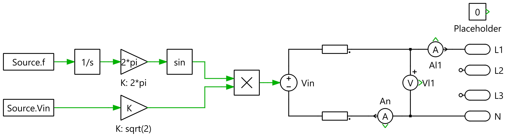

# Grid



Block `EVSE/GRID`, struct `Grid`. An ideal sine source in series with a resistance in line and neutral:

```
v_grid = √2 · Vin · sin(2π · f · t + phase)
```

L2/L3 are only used by the three-phase configuration.

| Key | Value | Meaning |
|---|---|---|
| `Config` | 1 | single phase |
| `Vin` | 230 Vrms | line voltage (swept as `Vin` in `sweep.py`; 85…265 Vrms is the design range) |
| `f` | 50 Hz | line frequency; also the fundamental of the harmonic analysis (`F0_PATH`) |
| `phase` | 0 rad | phase angle |
| `R` | 0 Ω | series resistance per conductor (set > 0 to model a weak grid) |
| `Ts` | 1/80 kHz | sampling time used inside the grid block |

`Grid.Vin` also sets the DC-link pre-charge (`DCLink.Vinit = √2·Vin`) and the start of the soft-start ramp ([control.md](control.md)).
