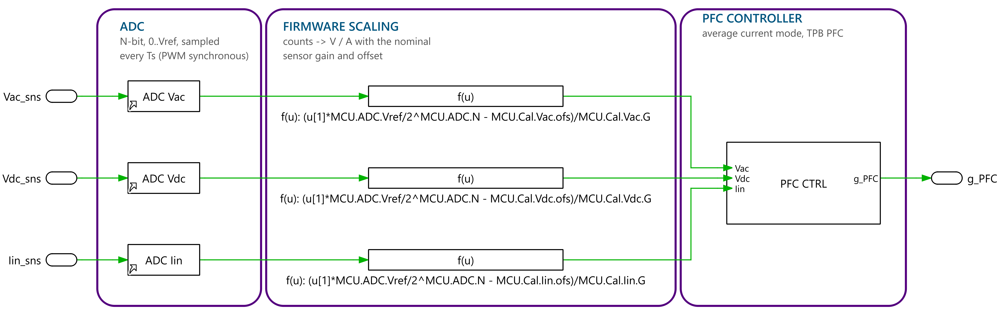
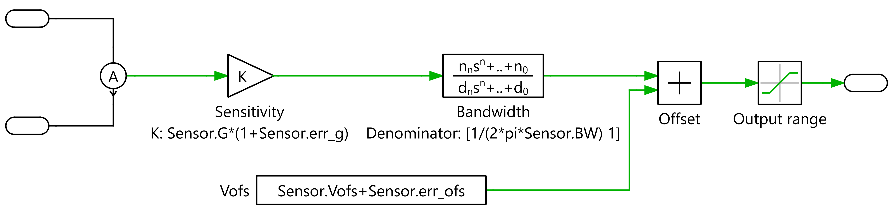
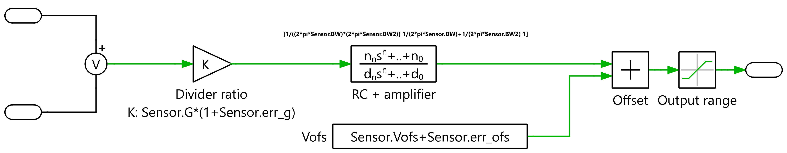
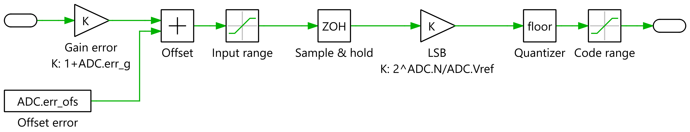

# Measurement chain and MCU



The controller never sees ideal signals. Three sensor blocks on the power stage produce the voltages a real board would deliver to the MCU pins. The `MCU` subsystem samples them with an ADC and converts them back to physical units, like the firmware does, before they reach `PFC CTRL` ([control.md](control.md)).

```
power stage ──► A (Iin) / V (Vac) / V2 (Vdc) ──► Goto Iin_sns, Vac_sns, Vdc_sns
                                                       │
MCU:  sensor voltage ──► ADC (12 bit, 3.3 V, once per PWM period) ──► scaling (MCU.Cal) ──► PFC CTRL ──► g_PFC
```

## Sensors (library `Sensors`, struct `Sensors`)

All sensors share one model:

```
v_out = clamp( Vofs + err_ofs + G·(1 + err_g)·x , Vmin , Vmax )     followed by the bandwidth poles
```

| Block | Library / mask | Placement | Hardware modelled | Default |
|---|---|---|---|---|
| `A` | `Sensors/A`, `Sensor = Sensors.Iin` | in series between the EMI filter and the PFC (line) | 5 mΩ shunt + AMC1301 + level shift | 50 mV/A around 1.65 V (±25 A → 0.4…2.9 V), 200 kHz |
| `V` | `Sensors/V`, `Sensor = Sensors.Vac` | across the PFC AC terminals | divider + RC anti-alias + AMC1311 (two poles) | 3.75 mV/V around 1.65 V (±400 V → 0.15…3.15 V), RC 10 kHz, amplifier 275 kHz |
| `V2` | `Sensors/V`, `Sensor = Sensors.Vdc` | across the PFC DC terminals | same as Vac | 6 mV/V (0…500 V → 0…3 V), RC 5 kHz, amplifier 275 kHz |





| Key | Unit | Meaning |
|---|---|---|
| `G` | V/A or V/V | sensitivity |
| `Vofs` | V | output at zero input (mid-rail for bipolar signals) |
| `BW` | Hz | first pole (amplifier for Iin, RC filter for the voltages) |
| `BW2` | Hz | second pole (isolated amplifier, voltage sensors only) |
| `err_g`, `err_ofs` | –, V | gain and offset error of the board |
| `Vmin`, `Vmax` | V | output clamp (ADC rails) |

`Sensors/HA` (Hall-effect current sensor) uses the same parameters as `A`, for Hall-type defaults.

> [!IMPORTANT]
> vac and iL are measured at the PFC terminals, not at the grid. If the current loop measures the grid current instead, it is closed through the EMI filter's LC resonances, which are close to its 8 kHz crossover, and the converter runs away.

## ADC (library `Sensors/ADC`, struct `MCU.ADC`)



One ADC block per channel, all with `ADC = MCU.ADC`:

1. gain and offset error (`err_g`, `err_ofs`);
2. clamp to the input range 0…`Vref`;
3. sample & hold every `Ts`, at `Toffs` into the period;
4. N-bit quantization (floor), output in counts 0…2ᴺ−1.

| Key | Value | Meaning |
|---|---|---|
| `N` | 12 bit | resolution |
| `Vref` | 3.3 V | full scale |
| `Ts` | 1/fsw | once per PWM period (set by `derived.py` when fsw is swept) |
| `Toffs` | 0 | sampling instant; with the carrier delay `CTRL.t_car` this is Ts/16 after the valley, i.e. the average inductor current |

## Firmware scaling (struct `MCU.Cal`)

The `Scale Iin/Vac/Vdc` blocks convert counts back to physical units:

```
x = (counts · Vref / 2ᴺ − Cal.ofs) / Cal.G
```

`MCU.Cal` holds the **nominal** sensor gain and offset (copied from `Sensors` without the errors). Errors set in `Sensors.err_g` / `err_ofs` therefore reach the controller as real measurement errors, which makes this the place to study calibration tolerance.

## Where to change what

| To model… | Edit |
|---|---|
| a different sensor or its tolerance | `Sensors` |
| a different MCU ADC | `MCU.ADC` |
| what the firmware assumes (calibration) | `MCU.Cal` |
