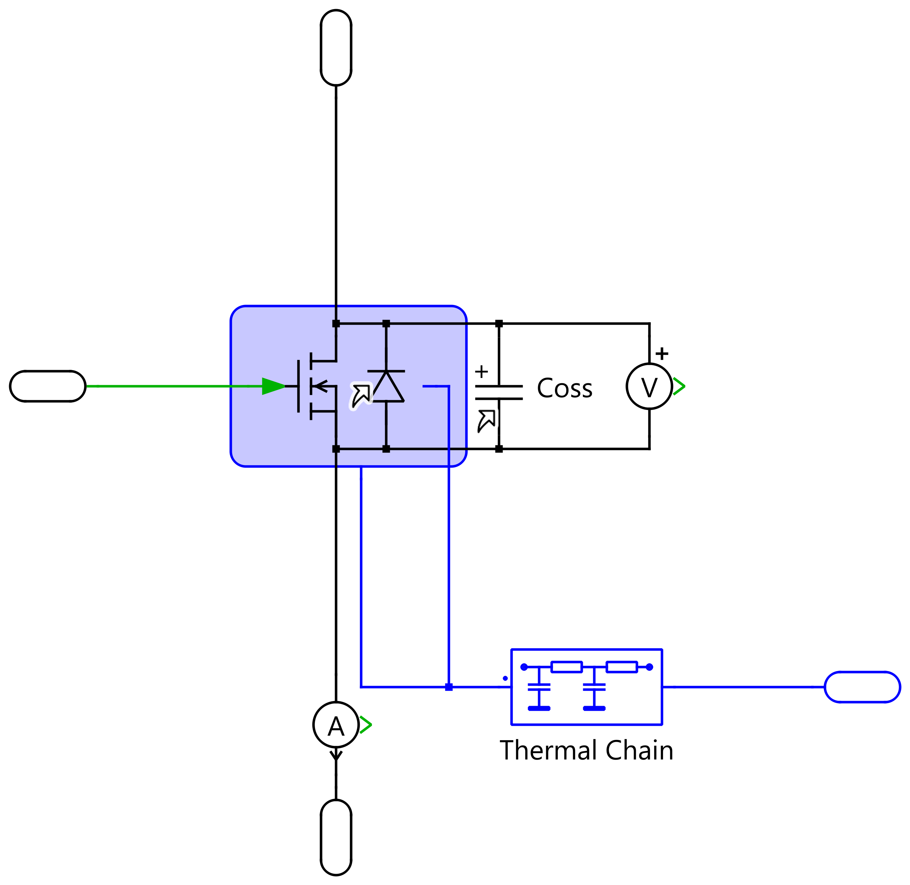

# Switches

Each of the six PFC switches is a `Switches/FET` block with:
- a thermal description (losses come from the PLECS Thermal Lib files);
- an output capacitance (Coss);
- a body diode;
- a thermal chain to the heatsink.

The switch thermal ports go to ambient through `Rth H-A` (`Thermals.rth_Amb`, `Thermals.T_amb`).

`Switches` in [parameters.py](../lib/parameters.py) is a small device library. `PFC_SWITCH` picks the device, and `PFC['SW']` is a copy of it.

## FET configurations (`Config`)

| Config | Model | Uses `Coss` / `therm_body_diode` |
|---|---|---|
| 1 | Real SW (body diode inside the thermal description) | no |
| 2 | Real SW + separate body diode | yes: `Passives/C` for Coss, `Switches/D` for the diode |
| 3 | Ideal | no |
| 4 | Pass | no |
| 5 | Short | no |

## Device: Wolfspeed C3M0021120K (selected)

1200 V / 100 A SiC MOSFET. Datasheet: [Wolfspeed_C3M0021120K_data_sheet.pdf](Wolfspeed_C3M0021120K_data_sheet.pdf).

| Key | Value | Meaning |
|---|---|---|
| `Config` | 1 | Real SW |
| `therm_mosfet` | `file:C3M0021120K` | thermal description |
| `ron_mosfet` | 21 mΩ | R_DS(on) at 25 °C |
| `Rgon` / `Rgoff` | 2.5 Ω | external gate resistance |
| `rth_sw` / `rth_ch` | 0.1 / 0.1 K/W | junction → case / case → heatsink |
| `foster_rth` / `foster_cth` | [0.0472, 0.0688] K/W / [0.95, 2.4] J/K | Foster thermal network |
| `T_init`, `Tamb`, `t_init` | 25 °C | initial / ambient temperatures (swept with `Tamb`) |

### Coss (`Coss`, library `Passives/C`, used with FET config 2)

| Key | Value |
|---|---|
| `Config` | 1: ESR + ESL (2 Ideal, 3 Pass) |
| `Cap_s` | 180 pF (at 800 V) |
| `Resr_s` / `Lesl_s` | 0.5 Ω / 2 nH |

### Body diode (`therm_body_diode`, library `Switches/D`, used with FET config 2)

| Key | Value | Meaning |
|---|---|---|
| `Config` | 1 | 1 Diode Thermal, 2 Diode Simple, 3 Pass, 4 Short |
| `therm_diode` | `file:C3M0021120K_bodydiode` | thermal description |
| `vf_diode` / `ron_diode` | 4.5 V / 5 mΩ | conduction model |
| `t_init` | 25 °C | initial junction temperature |
| `Case_Cth` | 0 J/K | case thermal capacitance |
| `Case_Tinit`, `Case_Amb_rth` | 25 °C, 0.1 K/W | case node → switch thermal port |

## Simulation speed

| Setting | Effect |
|---|---|
| Any Coss (config 1 or 2) | ≈ 15× slower. The solver follows the nanosecond charge/discharge at every edge. Example: 0.2 s took 816 s with Coss config 1 and FET config 2. |
| `Coss.Config = 3` (Pass) | fast; use it for long runs and sweeps |
| `Case_Cth > 0` | adds a thermal state and was ≈ 4× slower; 0 is accepted |
| FET config 3 (Ideal) | can hit the zero-crossing limit in the output voltage sensor; prefer 1 or 2 |
